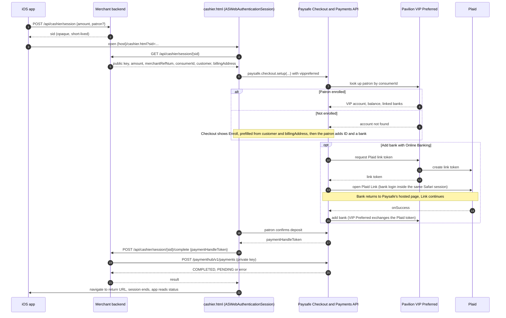

# Paysafe Checkout + VIP Preferred on iOS

A reference implementation of the **Paysafe Checkout SDK** with **VIP Preferred**, Pavilion's ACH payment method.
When a patron chooses VIP Preferred, Checkout opens **Plaid** so they can link a bank account. The repo contains an
iOS app and a small backend that complete a deposit end to end, including new-patron enrollment and bank login
through Plaid OAuth.

The app is a small sportsbook-style lobby with a cashier. Like a real operator cashier, it lists every deposit method
the operator offers (card, PayPal, Apple Pay, cage, wire and so on) on the operator's own screen. **VIP Preferred is
one of those choices** (eCheck/ACH - Bank Account), and it's the only one this sample implements. The other tiles are
there for realism and do nothing.

When the patron picks eCheck/ACH and taps **DEPOSIT**, the app opens Paysafe Checkout for **that one method**
(`displayPaymentMethods: ['vippreferred']`). The cashier page runs in a private **`ASWebAuthenticationSession`**
(backed by Safari) rather than an embedded `WKWebView`. That way, Plaid OAuth to the bank and back works just as it
does in Safari, which embedded web views don't reliably support, and the private session skips iOS's sign-in prompt.

| Piece | What it does |
|---|---|
| `CashierApp/` | SwiftUI app: lobby, the operator's deposit-method grid (`DepositMethodsView`), the eCheck/ACH amount page, patron entry and the `ASWebAuthenticationSession` launcher |
| `web/cashier.html` | The page that runs `paysafe.checkout.setup()` with VIP Preferred |
| `server/server.py` | Minimal merchant backend (Python standard library only): creates cashier sessions, serves the Checkout config and completes payments with the private key |
| `web/.well-known/apple-app-site-association` | Template AASA file for the Universal Link return |
| `project.yml` | [XcodeGen](https://github.com/yonaskolb/XcodeGen) spec that generates `CashierApp.xcodeproj` |
| `docs/returning-to-the-app.md` | How the cashier hands the result back to the app, and how to set up the Universal Link return |

> [!WARNING]
> **TEST environment only.** The server reads Paysafe TEST keys from a local `.env` file and lets the app supply
> test patron identities. Never use real SSNs, real bank credentials or production keys with this sample.

**Contents:** [How it works](#how-it-works) ·
[Checkout setup](#paysafe-checkout-setup-for-vip-preferred) · [Run it](#run-it) ·
[Set it up with a coding agent](#set-it-up-with-a-coding-agent) · [Returning to the app](#returning-to-the-app) ·
[Troubleshooting](#troubleshooting-test) · [Going to production](#going-to-production)

## How it works



1. **The app never holds a Paysafe key, and never puts the patron's SSN in a URL.** It asks the backend for a cashier
   session and gets back an opaque `sid`.
2. **The app opens the cashier page in a private `ASWebAuthenticationSession`** (`CheckoutLauncher.swift`,
   `AppConfig.privateCashierSession`). On iOS 17.4 or later with an HTTPS host, the session completes on a Universal
   Link (`https://{host}/cashier-return`). Otherwise it completes on the custom scheme `cashierdemo://cashier-return`.
3. **The page exchanges the `sid` for its Checkout config** and calls `paysafe.checkout.setup()` with VIP Preferred as
   the only payment method.
4. **Paysafe Checkout runs the whole VIP Preferred experience:** balance and linked banks for enrolled patrons, Add
   Bank Account (Online Banking through Plaid, or Manual Banking) and the Enroll flow for new patrons.
5. **When the patron confirms, Checkout returns a single-use `paymentHandleToken`.** The page posts it to the backend,
   which spends it with `POST /paymenthub/v1/payments` using the **private** key.
6. **The page shows Paysafe's success or failure screen, then navigates to the return URL.** That ends the session
   and hands the result to the app. The app treats the result as a hint and refreshes the balance from the backend.

## Paysafe Checkout setup for VIP Preferred

`web/cashier.html` calls:

```js
paysafe.checkout.setup(publicApiKey /* base64 of "username:password" */, {
  environment: 'TEST',
  simulator: 'EXTERNAL',              // TEST only; see below
  currency: 'USD',
  amount: 2500,                        // minor units ($25.00)
  locale: 'en_US',
  merchantRefNum: 'cashier-<uuid>',    // unique per attempt
  customer: {
    firstName, lastName, email, phone,
    dateOfBirth: { year, month, day },
  },
  billingAddress: { nickName, street, city, state, zip, country: 'US' },
  canEditAmount: false,
  displayPaymentMethods: ['vippreferred'],
  paymentMethodDetails: {
    vippreferred: {
      consumerId: '<9-digit SSN>',     // how VIP Preferred identifies the patron
      accountId: '<optional>',         // only if your merchant has more than one VIP Preferred account
    },
  },
}, resultCallback, closeCallback);
```

Things that are easy to get wrong:

- **`consumerId` is the patron's 9-digit SSN.** VIP Preferred finds the patron's account by it. An SSN that isn't
  enrolled yet gets Checkout's Enroll flow, not an error.
- **VIP Preferred requires `customer` and `billingAddress`.** Without them, setup fails with
  `Invalid fields: billingDetails`. For a new patron, these are the details Checkout prefills on the enrollment form.
- **Use `simulator: 'EXTERNAL'` in TEST.** By default, Paysafe's TEST environment uses an internal simulator that
  fakes VIP Preferred: Plaid shows "Something went wrong — Internal error occurred", and some payment amounts hang for
  about 60 seconds and then fail with HTTP 504. `EXTERNAL` routes VIP Preferred to Pavilion's test system. The backend
  also sends a `Simulator: EXTERNAL` header on its API calls. Never send either one outside TEST.
- **Keep the keys apart.** The public key goes to the browser and can only create single-use payment handles. The
  private key stays on the server and spends them.
- **Completing the payment.** The backend sends `merchantRefNum`, `amount`, `currencyCode`, `dupCheck: true`,
  `settleWithAuth: true` and `paymentHandleToken`. ACH can come back `PENDING`, so a real backend should confirm the
  final status through Paysafe webhooks before crediting the patron. If the call times out, look the payment up by
  `merchantRefNum` (`GET /paymenthub/v1/payments?merchantRefNum=...`) before retrying. The sample does this.

## Run it

### Requirements

- A Mac with Xcode 15.3 or later (iOS 17.4 SDK). The app runs on iOS 17.0 or later.
- [XcodeGen](https://github.com/yonaskolb/XcodeGen): `brew install xcodegen`
- Python 3.10 or later (no packages to install)
- Paysafe TEST credentials with VIP Preferred enabled, and a VIP Preferred test consumer ID from Pavilion

### Steps

1. **Clone the repo.**

   ```sh
   git clone https://github.com/PavilionPay/Paysafe-Pavilion-Test-App.git
   cd Paysafe-Pavilion-Test-App
   ```

2. **Configure the backend.**

   ```sh
   cp server/.env.example server/.env   # gitignored; never commit it
   ```

   Fill in:

   | Variable | Value |
   |---|---|
   | `PAYSAFE_PUBLIC_API_KEY` | Public (single-use token) key, as `username:password` or its base64 |
   | `PAYSAFE_PRIVATE_API_KEY` | Private (server-to-server) key, same format |
   | `PAYSAFE_VIPP_CONSUMER_ID` | A VIP Preferred test consumer ID from Pavilion (used for the default patron) |
   | `PAYSAFE_VIPP_ACCOUNT_ID` | Optional. Only needed if Paysafe set up more than one VIP Preferred account |

   Leave `PAYSAFE_ENVIRONMENT=TEST`. The `PAYSAFE_TEST_*` lines are optional overrides for the default patron's
   placeholder name and address, and `PORT` (default `8080`) sets the server port.

3. **Start the backend.**

   ```sh
   python3 -u server/server.py
   ```

   It serves `web/` and the cashier API on port 8080 and prints the environment and simulator it's using. Leave it
   running. The demo wallet balance lives in memory and resets when the server restarts.

4. **Generate the Xcode project and run the app.**

   ```sh
   xcodegen generate
   open CashierApp.xcodeproj
   ```

   Run the **CashierApp** target on an iPhone simulator with iOS 17.0 or later. The simulator reaches the backend at
   `http://localhost:8080`.

   To run on a physical iPhone:
   - Set `DEVELOPMENT_TEAM` in `project.yml` to your Apple team ID, then run `xcodegen generate` again.
   - In `CashierApp/AppConfig.swift`, point `cashierBaseURL` at your Mac's LAN address (for example
     `http://192.168.1.20:8080`). The iPhone and Mac must be on the same network. The generated `Info.plist` allows
     local-network HTTP for this.

5. **Make a deposit.** Tap the balance → **eCheck/ACH - Bank Account** → pick an amount → **DEPOSIT**.

### Choosing the patron

On the eCheck/ACH page, **Sample settings → Patron** sets who Checkout runs as:

- **Default test patron:** `PAYSAFE_VIPP_CONSUMER_ID` from `server/.env`, with placeholder contact details (built
  into `server.py`; override them with the `PAYSAFE_TEST_*` variables).
- **Existing:** enter only the SSN of a patron already enrolled in VIP Preferred. The server supplies placeholder
  contact details.

  > **Need existing test patrons?** Ask Pavilion. They can provide test patrons already enrolled in the VIP Preferred
  > test system, with linked banks and balances.

- **New:** enter a name, SSN, date of birth, phone, email and US address. Checkout shows its Enroll flow with these
  details prefilled, and the patron then adds an ID document and a bank account.

The backend accepts a patron from the app only when `PAYSAFE_ENVIRONMENT=TEST`. It keeps the patron with that one
session and logs only the last four digits of the SSN. The app keeps the patron in memory only. Use synthetic
identities.

The **Use Paysafe demo store** toggle opens Paysafe's public iGaming demo instead. It needs no keys or backend, but it
never returns a result to the app.

## Set it up with a coding agent

You can hand setup to a coding agent such as Claude Code that can run commands on your Mac. Copy the prompt below into
the agent from an empty folder (or from inside a clone of this repo). The agent does the setup and the automated
checks. You do the deposit itself, because Checkout, enrollment and Plaid need a person at the screen.

<details>
<summary><strong>Agent prompt</strong></summary>

````text
Set up and run the Paysafe Checkout + VIP Preferred iOS sample from
https://github.com/PavilionPay/Paysafe-Pavilion-Test-App on this Mac, then hand it to me to make a test deposit.
Read README.md in the repo first; it is the source of truth if anything below disagrees with it.

Ground rules (follow these at every step):
- This sample is for Paysafe's TEST environment only. Never change PAYSAFE_ENVIRONMENT from TEST, never use
  production keys, and never enter real SSNs or real bank credentials anywhere.
- Never invent credentials. If a required value is missing, stop and ask me for it.
- Never print, log or echo API keys or SSNs, including in summaries. Refer to them by variable name only.
- Never commit or push server/.env, and don't commit anything else unless I ask.
- Don't change app or server code to work around a problem. Tell me what failed and what you suggest.

1. Get the code.
   - If the current folder is not already a clone of this repo, run:
     git clone https://github.com/PavilionPay/Paysafe-Pavilion-Test-App.git && cd Paysafe-Pavilion-Test-App

2. Check prerequisites and report what is missing before going further.
   - macOS, with Xcode 15.3 or later: xcodebuild -version
   - At least one iPhone simulator runtime for iOS 17.0 or later: xcrun simctl list runtimes
   - XcodeGen: which xcodegen (if missing, ask me before running: brew install xcodegen)
   - Python 3.10 or later: python3 --version

3. Configure the backend.
   - If server/.env does not exist, copy server/.env.example to server/.env.
   - Check that PAYSAFE_PUBLIC_API_KEY, PAYSAFE_PRIVATE_API_KEY and PAYSAFE_VIPP_CONSUMER_ID have values, without
     printing them. If any is empty, ask me for the values (Paysafe TEST keys and a VIP Preferred test consumer ID
     from Pavilion), write them into server/.env, and keep PAYSAFE_ENVIRONMENT=TEST.
   - Confirm server/.env is ignored by git: git check-ignore server/.env

4. Start the backend in the background and keep it running.
   - Run: python3 -u server/server.py   (from the repo root; it listens on PORT from server/.env, default 8080)
   - If the port is already in use, tell me what is using it instead of killing it.
   - Check its startup line says "Paysafe TEST" and "simulator=EXTERNAL".

5. Smoke-test the backend (use the port from step 4).
   - curl -s http://localhost:8080/api/balance  -> JSON with a "balance" field
   - curl -s -X POST http://localhost:8080/api/cashier/session \
       -H 'Content-Type: application/json' -d '{"amount": 25}'
     -> HTTP 201 with a "sid"
   - curl -s http://localhost:8080/api/cashier/session/<sid>
     -> JSON config. Check that apiKey, consumerId, customer and billingAddress are present and non-empty and that
        environment is TEST, but do not print the apiKey or consumerId values.
   - curl -s -o /dev/null -w '%{http_code}' http://localhost:8080/cashier.html  -> 200

6. Build and launch the app in the simulator.
   - xcodegen generate
   - Pick an available iPhone simulator on iOS 17.0 or later (xcrun simctl list devices available), boot it if
     needed, and open Simulator.app.
   - Build for the simulator, for example:
     xcodebuild -project CashierApp.xcodeproj -target CashierApp -sdk iphonesimulator -configuration Debug build
     If that fails, run xcodebuild -list and build the CashierApp scheme with
     -destination 'platform=iOS Simulator,name=<simulator name>' instead. If the build fails only on code signing,
     retry with CODE_SIGNING_ALLOWED=NO.
   - Install the built CashierApp.app on the booted simulator (xcrun simctl install booted <path to .app>) and
     launch it (xcrun simctl launch booted com.pavilionpay.cashierdemo).
   - Leave AppConfig.cashierBaseURL at http://localhost:8080 for the simulator.

7. Hand off to me. Report, briefly:
   - Which prerequisites you found and their versions
   - The backend URL and the smoke-test results (pass or fail for each check)
   - Which simulator the app is running on
   - Anything you could not do, and why
   Then tell me to make a deposit: tap the balance -> "eCheck/ACH - Bank Account" -> pick an amount -> DEPOSIT, and
   to watch the backend log while I do. If I report an error, check the README's Troubleshooting (TEST) table and
   the backend log before suggesting a fix.
````

</details>

## Returning to the app

You set **one URL, the return URL**. The cashier page navigates to it when Checkout finishes, which closes the
`ASWebAuthenticationSession` and hands the result to the app.

| Term | What it means here | Who sets it |
|---|---|---|
| **Return URL** | Where the cashier page goes when Checkout finishes | **You** |
| **Custom scheme** | The return URL as `yourapp://cashier-return`. Works everywhere with no server setup; fine for development | You (option) |
| **Universal Link** | The return URL as `https://<your-domain>/cashier-return`. Apple verifies it, so no other app can receive it; recommended for production (HTTPS, iOS 17.4 or later) | You (option) |
| **Bank OAuth redirect URL** | Where the bank sends the patron after bank login: a page on Paysafe's Checkout host | Pavilion (already registered). **Nothing for you to do** (see the [note on banks with their own app](docs/returning-to-the-app.md#bank-login-nothing-to-configure)) |

See **[docs/returning-to-the-app.md](docs/returning-to-the-app.md)** for the steps, why the cashier runs in
`ASWebAuthenticationSession`, and how to set up the Universal Link return (domain, AASA file and entitlement).

## Troubleshooting (TEST)

| Symptom | Cause and fix |
|---|---|
| The app can't reach the backend | Check that `server/server.py` is running. On a physical iPhone, set `AppConfig.cashierBaseURL` to the Mac's LAN address, put both on the same network, and allow incoming connections to Python in the macOS firewall |
| "Cashier session expired" | Cashier sessions last 15 minutes and are lost when the server restarts. Start a new deposit |
| Setup fails: `Invalid fields: billingDetails` | Pass `customer` and `billingAddress` to `setup()` |
| Online Banking shows "Something went wrong — Internal error occurred" | Checkout is using Paysafe's internal simulator. Set `simulator: 'EXTERNAL'` |
| `POST /paymenthub/v1/payments` hangs for about 60 seconds, then returns HTTP 504 | Same cause: the internal simulator delays some amounts. Use `EXTERNAL`, and look the payment up by `merchantRefNum` before retrying |
| Enroll fails: "DL: An input error has been detected in the entry of the ID provided" | The ID number doesn't match the issuing state's format (for example, Ohio licenses are 2 letters followed by 6 digits) |
| Add bank fails: "Banking data not updated, previously registered and is now deactivated" | Plaid sandbox banks return the same shared account numbers to every tester. Use Manual Banking with a unique account number, or a custom Plaid sandbox user with its own numbers |
| The bank's own app opens (for example, Chase) and the patron ends up in Safari | This sample doesn't handle the return from a bank's app yet. Link the bank on its website instead, or use Manual Banking |
| The patron is "not enrolled" when you expected an existing account | The SSN isn't enrolled in the VIP Preferred test system. Use a test consumer ID from Pavilion |

## Going to production

- Host `cashier.html` and the API on your own HTTPS domain, and turn on the Universal Link return.
- Keep the private key in a secrets store, not a file. Remove the `simulator` option and header.
- Take the patron's identity from your own account system. Don't let the client choose the SSN; this sample does so
  only to exercise enrollment in TEST.
- Confirm deposits with Paysafe webhooks before crediting balances, and handle `PENDING`.
- Decide on `AppConfig.privateCashierSession`, and check with your risk team whether anything relies on a long-lived
  browser cookie.
