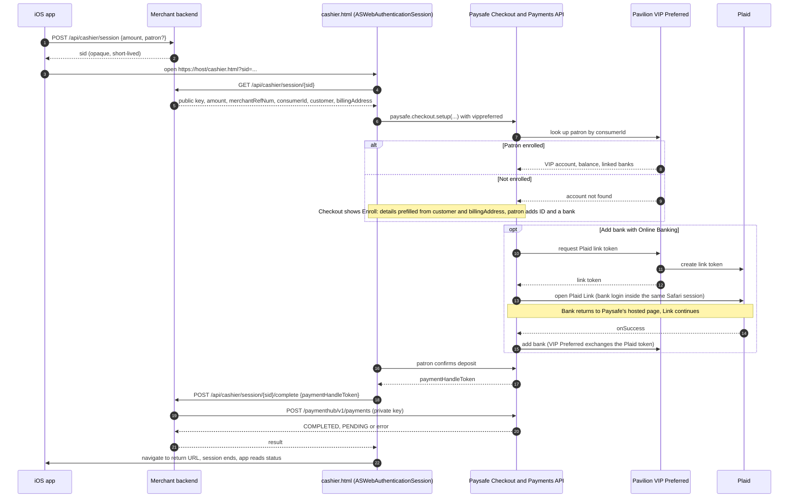

# Paysafe Checkout + VIP Preferred on iOS

A reference implementation of the **Paysafe Checkout SDK** using **VIP Preferred**, Pavilion's ACH payment method.
When a patron chooses VIP Preferred, Checkout opens **Plaid** so they can link their bank account. The repo contains
an iOS app and a small backend that complete a deposit end to end, including new-patron enrollment and bank login
through Plaid OAuth.

The app is a small sportsbook-style lobby with a cashier. Like a real operator cashier, it lists every deposit
method the operator offers (card, PayPal, Apple Pay, cage, wire, and so on) on the operator's own screen. **VIP
Preferred is one of those choices** (eCheck/ACH - Bank Account), and it's the only one this sample implements; the
other tiles are there for realism and do nothing.

When the patron picks eCheck/ACH and taps Deposit, the app opens Paysafe Checkout for **that one method**
(`displayPaymentMethods: ['vippreferred']`). It opens the cashier page in a private **`ASWebAuthenticationSession`**
(Safari-backed) instead of an embedded `WKWebView`. Plaid OAuth to the bank and back then works the way it does in
Safari, which an embedded web view does not support reliably, and the private session skips iOS's sign-in prompt.

| Piece | What it does |
|---|---|
| `CashierApp/` | SwiftUI app: lobby, the operator's deposit-method grid (`DepositMethodsView`), the eCheck/ACH amount page, patron entry, `ASWebAuthenticationSession` launcher |
| `web/cashier.html` | The page that runs `paysafe.checkout.setup()` with VIP Preferred |
| `server/server.py` | Minimal merchant backend (Python standard library only): issues cashier sessions, serves Checkout config, completes payments with the private key |
| `web/.well-known/apple-app-site-association` | Template AASA file for the Universal Link return |
| `project.yml` | [XcodeGen](https://github.com/yonaskolb/XcodeGen) spec that generates `CashierApp.xcodeproj` |

> **TEST environment only.** The server holds Paysafe TEST keys in a local `.env` file and lets the app supply
> test patron identities. Do not use real SSNs or production keys with this sample.

## How it works



1. **The app never holds a Paysafe key or the patron's SSN in a URL.** It asks the backend for a cashier session and
   gets back an opaque `sid`.
2. **The app opens the cashier page in a private `ASWebAuthenticationSession`** (`CheckoutLauncher.swift`,
   `AppConfig.privateCashierSession`). On iOS 17.4+ with an HTTPS host the session completes on a Universal Link
   (`https://host/cashier-return`). Otherwise it completes on the custom scheme `cashierdemo://cashier-return`.
3. **The page exchanges the `sid` for its Checkout config** and calls `paysafe.checkout.setup()` with VIP Preferred as
   the only payment method.
4. **Paysafe Checkout runs the whole VIP Preferred experience**: balance and linked banks for enrolled patrons, Add
   Bank Account (Online Banking via Plaid, or Manual Banking), and the Enroll flow for new patrons.
5. **When the patron confirms, Checkout returns a single-use `paymentHandleToken`.** The page posts it to the
   backend, and the backend spends it with `POST /paymenthub/v1/payments` using the **private** key.
6. **The page shows Paysafe's success or failure screen, then navigates to the return URL.** That ends the session
   and hands the result to the app. The app treats the result as a hint and refreshes the balance from the backend.

## Paysafe Checkout setup for VIP Preferred

`web/cashier.html` calls:

```js
paysafe.checkout.setup(publicApiKey /* base64 of "username:password" */, {
  environment: 'TEST',
  simulator: 'EXTERNAL',              // TEST only, see below
  currency: 'USD',
  amount: 2500,                        // minor units ($25.00)
  locale: 'en_US',
  merchantRefNum: 'cashier-<uuid>',    // unique per attempt
  customer: {
    firstName, lastName, email, phone,
    dateOfBirth: { year, month, day },
  },
  billingAddress: { nickName, street, city, state, zip, country: 'US' },
  canEditAmount: false,
  displayPaymentMethods: ['vippreferred'],
  paymentMethodDetails: {
    vippreferred: {
      consumerId: '<9-digit SSN>',     // how VIP Preferred identifies the patron
      accountId: '<optional>',         // only if your merchant has more than one VIP Preferred account
    },
  },
}, resultCallback, closeCallback);
```

Things that are easy to get wrong:

- **`consumerId` is the patron's 9-digit SSN.** VIP Preferred finds the patron's account by it. An SSN that isn't
  enrolled yet gets Checkout's Enroll flow instead of an error.
- **`customer` and `billingAddress` are required for VIP Preferred.** Without them setup fails with
  `Invalid fields: billingDetails`. For a new patron, these are the details Checkout prefills on the enrollment form.
- **`simulator: 'EXTERNAL'` in TEST.** Paysafe's TEST environment defaults to an internal simulator that fakes VIP
  Preferred: Plaid shows "Something went wrong — Internal error occurred", and some payment amounts hang about
  60 seconds and then fail with HTTP 504. `EXTERNAL` routes VIP Preferred to Pavilion's test system. The backend also
  sends a `Simulator: EXTERNAL` header on its API calls. Never send either outside TEST.
- **Public vs private key.** The public key goes to the browser and can only create single-use payment handles.
  The private key stays on the server and spends them.
- **Completing the payment.** The backend sends `merchantRefNum`, `amount`, `currencyCode`, `dupCheck: true`,
  `settleWithAuth: true` and `paymentHandleToken`. ACH can come back `PENDING`; a real backend should confirm the
  final status through Paysafe webhooks before crediting the patron. If the call times out, look the payment up by
  `merchantRefNum` (`GET /paymenthub/v1/payments?merchantRefNum=...`) before retrying; the sample does this.

## Run it

Requirements: Xcode 15.3 or later (iOS 17.4 SDK), [XcodeGen](https://github.com/yonaskolb/XcodeGen)
(`brew install xcodegen`), Python 3.10 or later, and Paysafe TEST credentials with VIP Preferred enabled.

1. **Configure the backend.**
   ```sh
   cp server/.env.example server/.env   # gitignored; never commit it
   ```
   Fill in:
   - `PAYSAFE_PUBLIC_API_KEY`: public (single-use token) key, as `username:password` or its base64
   - `PAYSAFE_PRIVATE_API_KEY`: private (server-to-server) key, same format
   - `PAYSAFE_VIPP_CONSUMER_ID`: a VIP Preferred test consumer ID from Pavilion (the default patron)
   - `PAYSAFE_VIPP_ACCOUNT_ID`: optional, only if Paysafe set up more than one VIP Preferred account
2. **Start the backend:** `python3 -u server/server.py` (port 8080; serves `web/` and the cashier API).
3. **Generate and open the project:** `xcodegen generate`, then open `CashierApp.xcodeproj` and run on an iOS 17+
   simulator.
   - On a physical iPhone: set `DEVELOPMENT_TEAM` in `project.yml` and point `AppConfig.cashierBaseURL` at your Mac's
     LAN address (for example `http://192.168.1.20:8080`). `Info.plist` allows local-network HTTP for this.
4. **Make a deposit:** tap the balance → **eCheck/ACH - Bank Account** → pick an amount → **DEPOSIT**.

### Choosing the patron

On the eCheck/ACH page, **Sample settings → Patron** lets you choose who Checkout runs as:

- **Default test patron:** the `PAYSAFE_VIPP_CONSUMER_ID` and placeholder details from `server/.env`.
- **Existing:** enter only an SSN for a patron already enrolled in VIP Preferred. The server supplies placeholder
  contact details.

  > **Need existing test patrons?** Work with Pavilion. They can provide test patron data already enrolled in the
  > VIP Preferred test system, with linked banks and balances.
- **New:** enter name, SSN, date of birth, phone, email and a US address. Checkout shows its Enroll flow with these
  details prefilled; the patron then adds an ID document and a bank account.

The backend accepts a patron only when `PAYSAFE_ENVIRONMENT=TEST`, keeps it with that one session, and logs only the
SSN's last four digits. The app keeps it in memory. Use synthetic identities.

The **Use Paysafe demo store** toggle opens Paysafe's public iGaming demo instead. It needs no keys, but it never
returns a result to the app.

## Returning to the app

You set **one URL, the return URL**. The cashier page navigates to it when Checkout finishes, which closes the
`ASWebAuthenticationSession` and hands the result to the app.

| Term | What it means here | Who sets it |
|---|---|---|
| **Return URL** | Where the cashier page goes when Checkout finishes | **You** |
| **Custom scheme** | Return URL as `yourapp://cashier-return`: works everywhere, no server setup; fine for development | You (option) |
| **Universal Link** | Return URL as `https://<your-domain>/cashier-return`: Apple-verified, so no other app can receive it; recommended for production (HTTPS, iOS 17.4+) | You (option) |
| **Bank OAuth redirect URL** | Where the bank sends the patron after bank login; a page on Paysafe's Checkout host | Pavilion (already registered). **Nothing for you to do** (see the [note on banks with their own app](docs/returning-to-the-app.md#bank-login-nothing-to-configure)) |

See **[docs/returning-to-the-app.md](docs/returning-to-the-app.md)** for the steps, why the cashier runs in
`ASWebAuthenticationSession`, and the Universal Link setup (domain, AASA file, entitlement).

## Troubleshooting (TEST)

| Symptom | Cause and fix |
|---|---|
| Setup fails: `Invalid fields: billingDetails` | Pass `customer` and `billingAddress` to `setup()` |
| Online Banking shows "Something went wrong — Internal error occurred" | Checkout is on Paysafe's internal simulator. Set `simulator: 'EXTERNAL'` |
| `POST /paymenthub/v1/payments` hangs ~60 s, then HTTP 504 | Same cause (internal simulator delays some amounts). Use `EXTERNAL`; look the payment up by `merchantRefNum` before retrying |
| Enroll fails: "DL: An input error has been detected in the entry of the ID provided" | The ID number doesn't match the issuing state's format (for example, Ohio licenses are 2 letters + 6 digits) |
| Add bank fails: "Banking data not updated, previously registered and is now deactivated" | Plaid sandbox banks return the same shared account numbers to every tester. Use Manual Banking with a unique account number, or a custom Plaid sandbox user with its own numbers |
| The bank's own app opens (for example Chase) and the patron ends up in Safari | The return from a bank's app isn't covered by this sample yet. Link the bank on its website instead, or use Manual Banking |
| Patron "not enrolled" when you expected an existing account | The SSN isn't enrolled in the VIP Preferred test system; use a test consumer ID provided by Pavilion |

## Going to production

- Host `cashier.html` and the API on your own HTTPS domain and enable the Universal Link return.
- Keep the private key in a secrets store, not a file. Remove the `simulator` option and header.
- Take the patron's identity from your own account system. Don't let the client pick the SSN; this sample does so only
  to exercise enrollment in TEST.
- Confirm deposits with Paysafe webhooks before crediting balances, and handle `PENDING`.
- Decide on `AppConfig.privateCashierSession`, and check with your risk team whether anything relies on a long-lived
  browser cookie.
